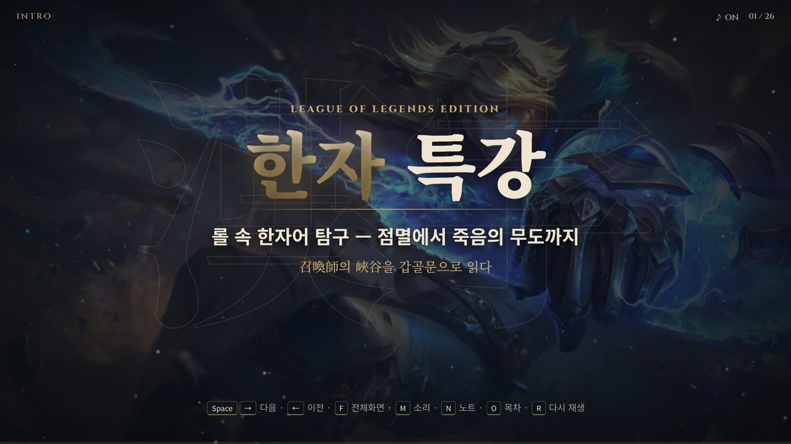

# 한자 특강

게임과 일상에서 쓰는 단어 속 한자를 갑골문 · 금문 · 소전까지 거슬러 올라가 읽는 한자 특강 자료 모음입니다.
레슨마다 폴더 하나로 되어 있고, 각 레슨은 브라우저에서 바로 여는 발표 자료입니다.
실제 영상과 사진 위에 이펙트를 겹쳐 몰입감 있게 수업할 수 있도록 만들었습니다.

## 목차

- [레슨 목록](#레슨-목록)
- [사용 방법](#사용-방법)
- [저장소 구조](#저장소-구조)
- [자료 출처와 이용](#자료-출처와-이용)

## 레슨 목록

| 레슨 | 주제 | 다루는 한자 · 용어 |
| --- | --- | --- |
| [롤 속 한자어 탐구](lol-hanja/README.md) | 리그 오브 레전드 소환사 주문 · 아이템 이름 속 한자, 보너스로 게임 용어 | 點滅 · 點火 · 幽體化 · 劍 vs 刀 · 舞蹈 · 갱 · 로밍 |

[](lol-hanja/README.md)

### [롤 속 한자어 탐구 — 점멸에서 죽음의 무도까지](lol-hanja/README.md)

- **1장 소환사 주문** — 점멸(點滅) · 점화(點火) · 유체화(幽體化)를 한 글자씩 갑골문까지 해부합니다. 點은 왜 ‘불을 켜다’이고, 幽는 왜 ‘희미하다’일까요?
- **2장 아이템 속 무기** — 몰락한 왕의 검은 왜 ‘검(劍)’일까요? 劍과 刀의 차이, 그리고 죽음의 무도의 ‘도’에 숨은 함정을 다룹니다.
- **보너스** — 한자어는 아니지만 매일 쓰는 ‘갱’과 ‘로밍’의 뜻과 어원을 살펴봅니다.

자세한 장면 구성 · 스크린샷 · 조작키는 [레슨 문서](lol-hanja/README.md)에 있습니다.

## 사용 방법

1. 저장소를 내려받습니다.

   ```sh
   git clone https://github.com/Stephan1226/hanja-lesson.git
   ```

2. 원하는 레슨 폴더의 `index.html`을 Chrome에서 엽니다. 별도 설치나 서버가 필요 없습니다.
3. 시작 화면에서 클릭하거나 아무 키나 누르면 시작합니다. <kbd>Space</kbd> · <kbd>→</kbd>로 넘기고, <kbd>F</kbd>는 전체화면, <kbd>N</kbd>은 발표자 노트, <kbd>O</kbd>는 목차입니다.

## 저장소 구조

```
hanja-lesson/
├── README.md        # 지금 보는 문서
└── lol-hanja/       # 롤 속 한자어 탐구
    ├── README.md    # 레슨 설명 · 스크린샷 · 조작키
    ├── index.html   # 발표 자료 (브라우저로 열기)
    ├── css/ · js/   # 스타일, 장면 진행, 이펙트 엔진
    ├── assets/      # 영상, 이미지, 고문자 SVG
    ├── docs/        # 문서용 스크린샷
    └── tools/       # 고문자 데이터 생성 스크립트
```

새 레슨은 같은 방식으로 폴더를 하나 더 만들고, 위 [레슨 목록](#레슨-목록)에 한 줄 추가합니다.

## 자료 출처와 이용

- 고문자 자형은 Wikimedia Commons의 퍼블릭 도메인 SVG를, 박물관 사진은 CC0 · CC BY-SA 자료를 썼습니다. 레슨별 출처는 각 레슨 문서와 발표 자료의 마지막 장면에 있습니다.
- 게임 영상과 이미지는 각 게임사의 저작물입니다. [롤 속 한자어 탐구](lol-hanja/README.md)의 League of Legends 자료는 Riot Games의 팬 콘텐츠 정책에 따른 비상업적 교육용 사용입니다.
