# 동양의 르네상스 — 空에서 理로

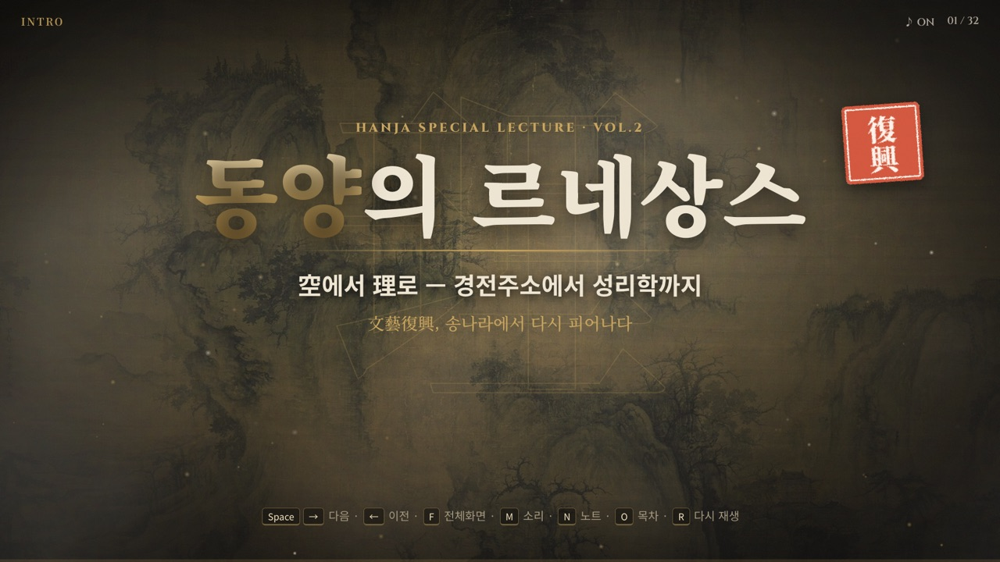

송나라에서 일어난 ‘동양의 르네상스’, 곧 성리학의 탄생을 한자로 따라가는 한자 특강입니다.
글자 풀이에 갇힌 한·당의 유교(경전주소), 그 빈자리를 채운 불교·도교와 《서유기》, 여진의 침략, 그리고 유교를 다시 일으킨 성리학까지 이어집니다.
옛 그림과 실제 판본 사진 위에 갑골문을 새기고, 단어마다 **갑골문 → 지금의 뜻 → 단어로 넓히기** 순서로 풉니다.
브라우저에서 바로 여는 32장면짜리 발표 자료이고, 20분 수업용 압축판(19장면)도 함께 있습니다.

## 목차

- [실행 방법](#실행-방법)
- [조작키](#조작키)
- [레슨 구성](#레슨-구성)
  - [도입](#도입-15)
  - [1장 · 낡은 교과서](#1장--낡은-교과서-610)
  - [2장 · 마음의 시대](#2장--마음의-시대-1117)
  - [3장 · 위기](#3장--위기-1819)
  - [4장 · 다시 유교의 가르침을 살리다](#4장--다시-유교의-가르침을-살리다-2026)
  - [5장 · 오늘의 학문 속 성리학](#5장--오늘의-학문-속-성리학-27)
  - [마무리](#마무리-2832)
- [20분 버전](#20분-버전)
- [화면 위 이펙트](#화면-위-이펙트)
- [수업 전에 알아 둘 점](#수업-전에-알아-둘-점)
- [폴더 구조](#폴더-구조)
- [고문자 데이터 다시 만들기](#고문자-데이터-다시-만들기)
- [출처 · 참고 자료](#출처--참고-자료)

## 실행 방법

1. `index.html`(전체판, 32장면)이나 `20min.html`([20분 버전](#20분-버전), 19장면)을 Chrome에서 엽니다. (더블클릭하면 됩니다. 서버 없이 `file://`로 동작합니다.)
2. 시작 화면에서 클릭하거나 아무 키나 누르면 효과음이 켜지며 시작합니다.
3. 강의실 화면에 맞추려면 <kbd>F</kbd>로 전체화면을 켭니다. 화면 비율이 달라도 16:9 무대가 자동으로 맞춰집니다.

- 주소 끝에 `#장면.단계`를 붙이면 그 지점으로 바로 갑니다. 예: `index.html#19.3` → 19번 장면(정강의 변 지도) 3단계
- 글꼴은 Google Fonts(Noto Serif KR · Noto Serif TC · Noto Sans KR · Cinzel)를 불러옵니다. 인터넷이 없으면 macOS 기본 글꼴로 대신 보입니다.

## 조작키

한/영 입력 상태와 관계없이 동작합니다. 발표용 리모컨(PageUp/PageDown)도 쓸 수 있습니다.

| 키 | 동작 |
| --- | --- |
| <kbd>Space</kbd> · <kbd>→</kbd> · <kbd>↓</kbd> · <kbd>PageDown</kbd> · <kbd>Enter</kbd> | 다음 단계 / 다음 장면 |
| <kbd>←</kbd> · <kbd>↑</kbd> · <kbd>PageUp</kbd> · <kbd>Backspace</kbd> | 이전 |
| 화면 클릭 | 왼쪽 1/4은 이전, 나머지는 다음 |
| <kbd>F</kbd> | 전체화면 |
| <kbd>M</kbd> | 효과음 켜기/끄기 |
| <kbd>N</kbd> | 발표자 노트 (장면별 배경 설명 · 학생에게 던질 질문) |
| <kbd>O</kbd> · <kbd>Esc</kbd> | 목차 열기 / 닫기 — 장면을 눌러 바로 이동 |
| <kbd>R</kbd> | 지금 장면을 처음부터 다시 재생 |
| <kbd>Home</kbd> · <kbd>End</kbd> | 첫 장면 / 마지막 장면 |

## 레슨 구성

한 장면 안에서도 <kbd>Space</kbd>를 누를 때마다 내용이 한 단계씩 나타납니다. 학생들에게 먼저 짐작하게 한 뒤 넘기기 좋게 짰습니다.
발표자 노트(<kbd>N</kbd>)에는 장면마다 배경 지식과 질문을 적어 두었습니다. 내용이 낯설어도 노트만 읽으면 설명할 수 있게 썼습니다.

### 도입 (1–5)

| # | 장면 | 내용 |
| --- | --- | --- |
| 1 | 타이틀 | 곽희 〈조춘도〉 위로 큰 글자 空이 사라지고 理가 떠오름 |
| 2 | 오늘의 질문 | ‘공부’ · 손오공 · 理 · 1000원/5000원권 · 르네상스 — 수업 중에 하나씩 답이 나옴 |
| 3 | 르네상스 = 文藝復興 | 라파엘로 〈아테네 학당〉 위에 文藝復興이 쾅 |
| 4 | 復 · 興 | 갑골문: 집으로 되돌아오는 발 · 네 손이 함께 들어 올림 → 復興 |
| 5 | 동양에도 르네상스가? | 〈청명상하도〉 · 송나라의 인쇄 · 도시 · 사대부 → “무엇이 다시 일어났을까?” 儒敎 도장 |

<p>
  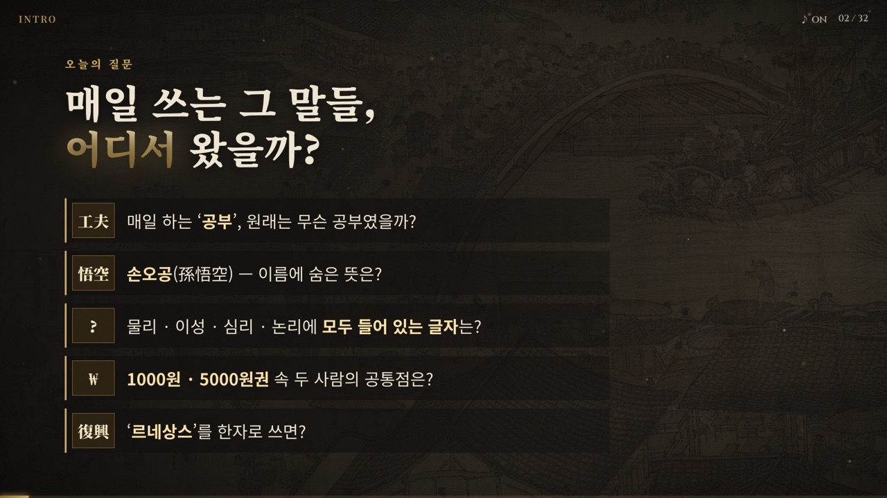
  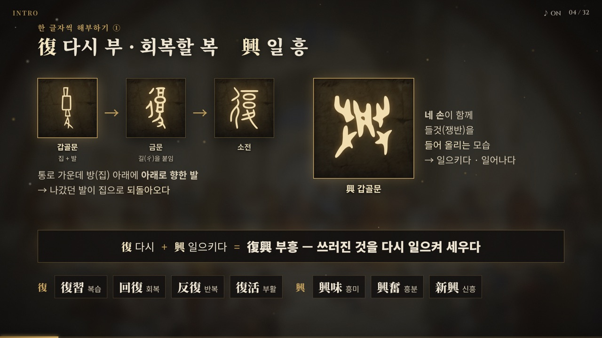
</p>

### 1장 · 낡은 교과서 (6–10)

진시황의 분서 이후 한나라 학자들은 글자 하나하나를 되살리는 **훈고학**에 매달렸습니다. 經 · 傳 · 注 · 疏를 한 글자씩 풀고, 실제 《예기주소》 판본 위에 경 · 주 · 소를 표시해 “교과서 → 선생님 해설 → 자습서 → 해설지의 해설지”로 풀이 위에 풀이가 쌓인 구조를 보여 줍니다.

<p>
  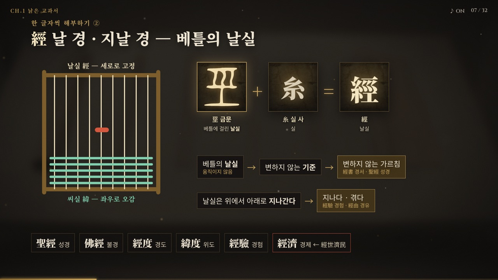
  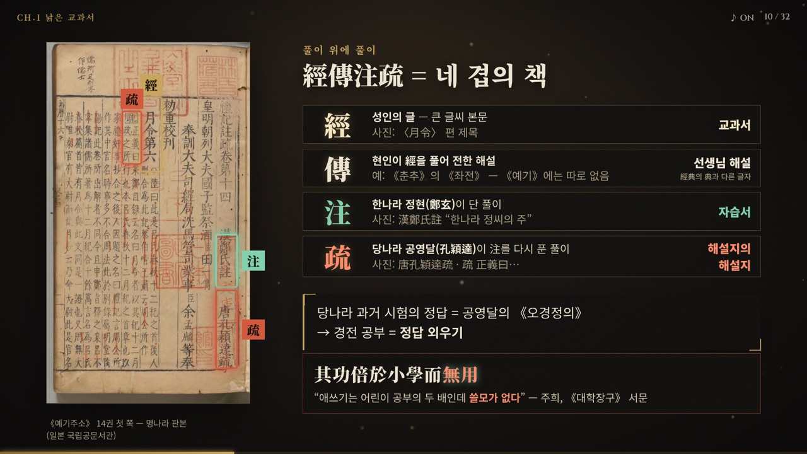
</p>

<details>
<summary>1장 장면 목록</summary>

| # | 장면 | 내용 |
| --- | --- | --- |
| 6 | CH.1 낡은 교과서 | 죽간 위 불꽃 — 분서 → 훈고학(訓詁學) |
| 7 | 經 — 날실 | 베틀 애니메이션 · 巠 금문 + 糸 → 經書 · 經度/緯度 · 經濟 |
| 8 | 傳 — 돌려 넘겨 전하다 | 專 갑골문(손으로 실패를 돌림) + 亻 → 傳 → 經傳 → 같은 ‘경전’, 다른 ‘전’: 종교 경전의 經典 vs 《공양전》 · 《곡량전》의 傳 |
| 9 | 注 · 疏 | 물을 부어 넣는 注, 막힌 것을 트는 疏 |
| 10 | 經傳注疏 = 네 겹의 풀이 | 경 · 전 · 주 · 소 네 층 + 《예기주소》 실물: 漢鄭氏註 · 唐孔穎達疏 · 正義曰 표시 → 주희의 평 “無用” |

</details>

### 2장 · 마음의 시대 (11–17)

큰 질문에 답해 준 불교 · 도교의 시대. 《서유기》가 당 → 송 → 명을 거쳐 자란 이야기라는 퀴즈, 孫悟空의 이름 풀이, 空 · 無我 · 心을 거쳐, 주희가 《대학장구》 서문 한 문장으로 옛 유학과 불교 · 도교를 함께 비판하는 장면으로 끝납니다.

<p>
  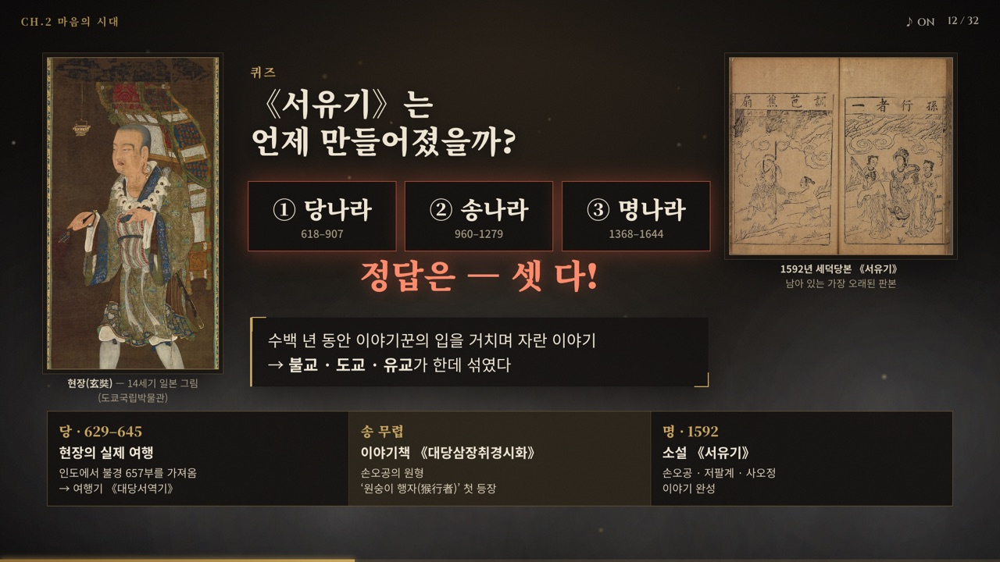
  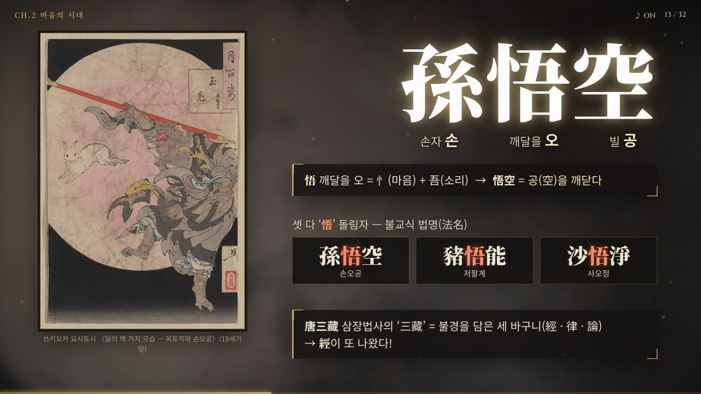
</p>
<p>
  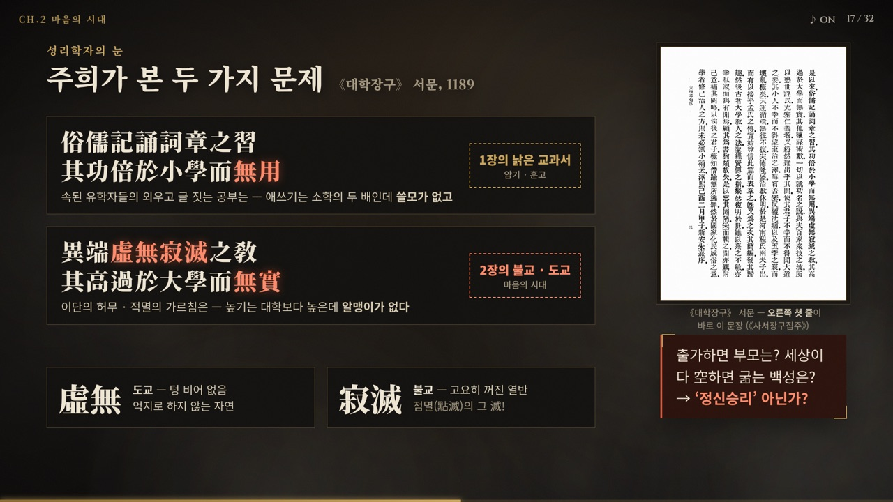
</p>

<details>
<summary>2장 장면 목록</summary>

| # | 장면 | 내용 |
| --- | --- | --- |
| 11 | CH.2 마음의 시대 | 868년 《금강경》(날짜가 남은 가장 오래된 인쇄 책) |
| 12 | 《서유기》는 언제? | 퀴즈 → “셋 다!” · 현장(당) → 《대당삼장취경시화》(송) → 세덕당본(명, 1592) |
| 13 | 孫悟空의 이름 | 요시토시 판화 · 悟空 = 공을 깨닫다 · 悟能 · 悟淨 돌림자 · 三藏의 經 |
| 14 | 空 — 텅 빔 | 穴 + 工 → 空 · 색즉시공 |
| 15 | 無我 — 나는 없다 | 춤추는 사람(無) + 톱날 창(我) — 둘 다 가차 · 아집 · 무아지경 |
| 16 | 心 — 마음 원숭이 | 심장 → 마음 · 心猿 · 조여드는 긴고아 · 수보리조사 |
| 17 | 虛無寂滅 — 주희의 비판 | 《대학장구》 서문 실물 · 無用 / 無實 · ‘정신승리?’ |

</details>

### 3장 · 위기 (18–19)

휘종이 그린 〈서학도〉로 ‘붓의 나라’ 송을 소개하고, 직접 그린 약도 위에서 요 · 서하 · 금 · 고려와 정강의 변(1127), 남송으로 이어지는 흐름을 단계별로 보여 줍니다.

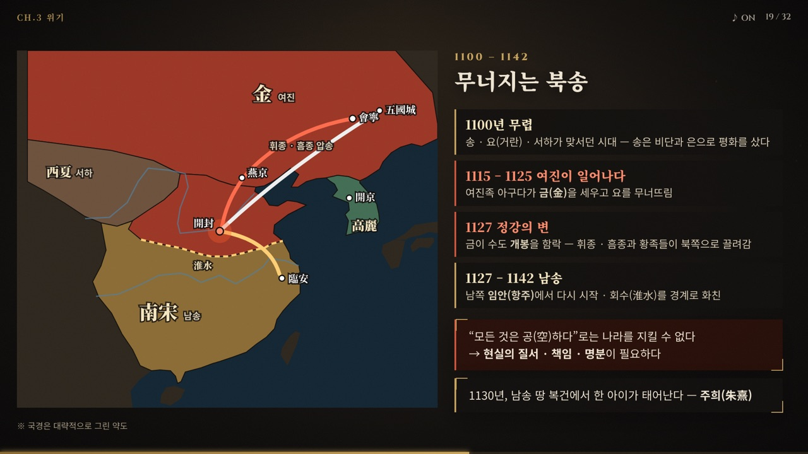

| # | 장면 | 내용 |
| --- | --- | --- |
| 18 | CH.3 북쪽에서 내려오다 | 〈서학도〉(1112) · 전연의 맹약 · 휘종과 흠종이 끌려가다 |
| 19 | 1127 정강의 변 | 지도: 금의 남하 → 개봉 함락 → 휘종 · 흠종 압송 → 남송 · 회수 경계 → 1130년 주희 탄생 |

### 4장 · 다시 유교의 가르침을 살리다 (20–26)

한유 → 북송 학자들 → 주희로 이어지는 성리학의 계보, 같은 학문의 일곱 가지 이름, 性 · 理 · 氣를 풀고 無我와 性卽理를 맞세웁니다. 화씨벽 이야기에서는 돌이 갈라지며 옥의 결이 드러납니다.

<p>
  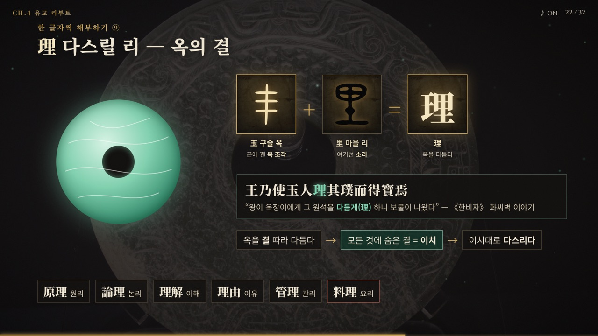
  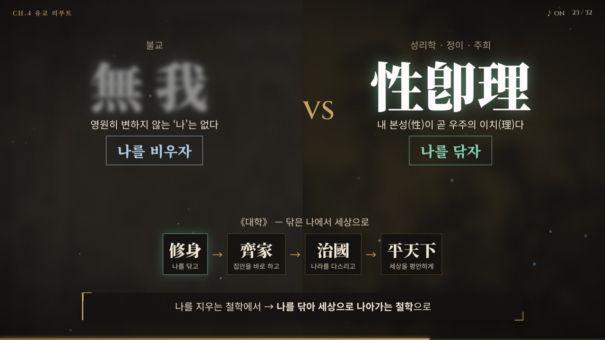
</p>

<details>
<summary>4장 장면 목록</summary>

| # | 장면 | 내용 |
| --- | --- | --- |
| 20 | CH.4 다시 유교의 가르침을 살리다 | 주희 초상 · 한유 → 주돈이 · 정호 · 정이 → 주희 · 이름 일곱 |
| 21 | 性 — 타고난 마음 | 生(새싹) + 忄 → 性 · 성선설 |
| 22 | 理 — 옥의 결 | 玉 + 里 · 《한비자》 화씨벽 · 결 → 이치 · 料理 |
| 23 | 無我 vs 性卽理 | 나를 비우자 ↔ 나를 닦자 · 수신제가치국평천하 |
| 24 | 氣 — 흐르는 기운 | 三 vs 气 갑골문 퀴즈 · 气 → 氣(+米) · 理와 氣 비유 |
| 25 | 五經에서 四書로 | 《예기》에서 꺼낸 《대학》 · 《중용》 · 注疏 → 集注 · 訓詁 → 義理 |
| 26 | 格物致知 · 窮理 | 各(다다르는 발) → 格 · 굴 끝까지 비추는 窮 → ‘궁리하다’ |

</details>

### 5장 · 오늘의 학문 속 성리학 (27)

Physics · Reason · Psychology · Logic · Metaphysics · Economy · Science(청나라 말) · 공부 · 궁리 — 카드 9장을 하나씩 뒤집으며, 근대에 서양 학문을 성리학 용어로 번역한 흔적을 찾습니다.

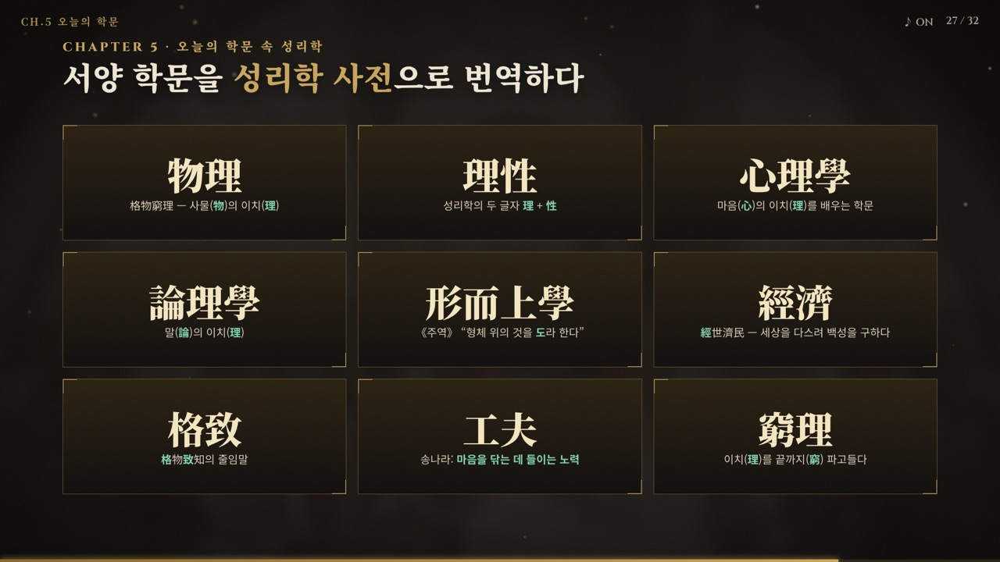

### 마무리 (28–32)

동서 르네상스 비교표 → 안향에서 조선, 이황 · 이이로 이어지는 한국의 성리학 → 복습 퀴즈 4문제 → 오늘 다시 일으킨 한자 12자와 溫故知新 → 출처 장면.

<p>
  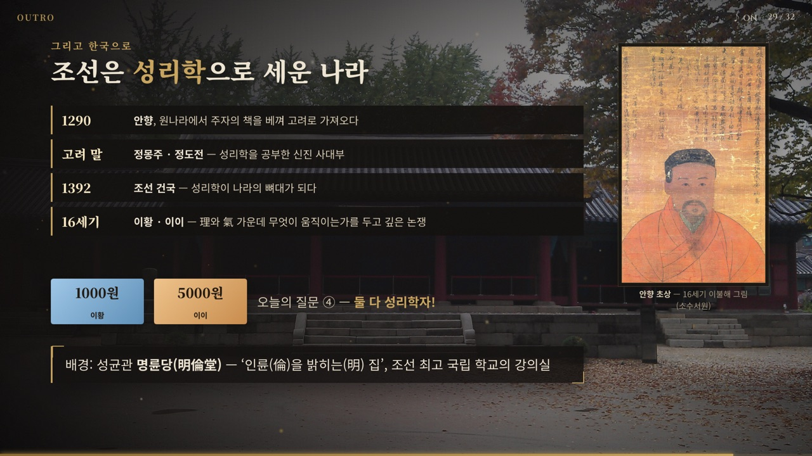
  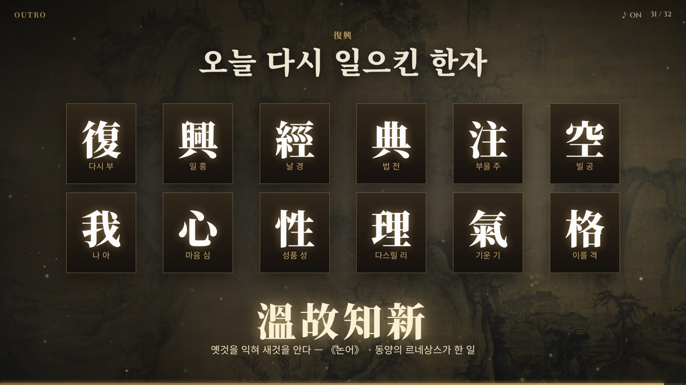
</p>

## 20분 버전

`20min.html`은 같은 이야기를 20분 안에 마치도록 줄인 압축판입니다. 19장면이고, 그림 · 글자 · 효과는 전체판과 같은 파일을 씁니다.

- 한자 해부는 다섯 장면입니다: 復 · 興 → 經 → 空 → 性 → 理.
- 발표자 노트(<kbd>N</kbd>)는 그대로 읽어도 되는 짧은 대본입니다. 맨 위 ⏱ 줄에 장면별 목표 시간과 누적 시간이 있습니다.
- 빠진 내용(傳 · 注 · 疏 글자 해부, 無我 · 心 · 氣, 사서 · 격물궁리, 동서 비교표, 복습 퀴즈 등)은 전체판에 그대로 있습니다. 시간이 남거나 질문이 나오면 전체판의 해당 장면을 여세요.

| # | 장면 | 시간 | 누적 | 전체판 |
| --- | --- | --- | --- | --- |
| 1 | 타이틀 | 0:20 | 0:20 | 1 |
| 2 | 오늘의 질문 | 0:40 | 1:00 | 2 |
| 3 | 르네상스 = 文藝復興 | 1:00 | 2:00 | 3 |
| 4 | 復 · 興 | 1:30 | 3:30 | 4 |
| 5 | 동양에도 르네상스가? | 1:00 | 4:30 | 5 |
| 6 | 經 — 날실 | 1:30 | 6:00 | 7 |
| 7 | 經傳注疏 = 네 겹의 풀이 | 1:30 | 7:30 | 10 — 傳 · 注 · 疏의 뜻을 한 줄씩 넣음 |
| 8 | 《서유기》는 언제? | 1:00 | 8:30 | 12 |
| 9 | 空 — 손오공의 ‘공’ | 1:30 | 10:00 | 13 · 14를 합치고 15의 無我를 한 줄로 |
| 10 | 주희의 비판 | 1:30 | 11:30 | 17 |
| 11 | 1127 정강의 변 | 1:30 | 13:00 | 19 |
| 12 | 다시 유교의 가르침을 살리다 | 0:45 | 13:45 | 20 — 계보 · 이름 일곱 개 대신 性 + 理 |
| 13 | 性 — 타고난 마음 | 1:00 | 14:45 | 21 |
| 14 | 理 — 옥의 결 | 1:30 | 16:15 | 22 |
| 15 | 無我 vs 性卽理 | 1:00 | 17:15 | 23 |
| 16 | 오늘의 학문 속 성리학 | 1:15 | 18:30 | 27 — 카드 9장 → 6장 |
| 17 | 그리고 한국으로 | 0:45 | 19:15 | 29 — 연표 4줄 → 3줄 |
| 18 | 오늘 다시 일으킨 한자 | 0:30 | 19:45 | 31 — 12자 → 6자 |
| 19 | 출처 | — | — | 32 |

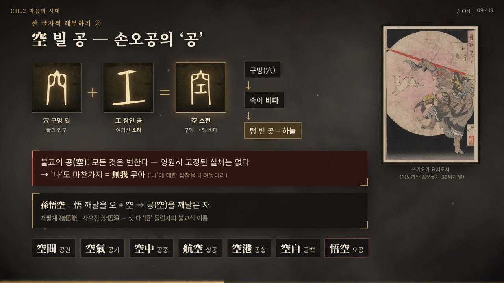

## 화면 위 이펙트

- **고문자 새김** — 갑골문 · 금문 · 소전 그림이 거북 배딱지 질감의 칸 위에 금빛 윤곽선부터 새겨진 뒤 채워집니다.
- **장면별 연출** — 불타는 죽간(분서), 날실 사이를 오가는 씨실, 물이 쏟아지는 注, 근두운 구름, 조여드는 긴고아, 북소리와 함께 남하하는 화살표, 갈라지는 옥 원석, 굴 끝까지 파고드는 빛.
- **효과음** — 파일 없이 브라우저(WebAudio)에서 즉석으로 합성합니다. 절 종소리 · 목탁 · 전고(북) · 붓질 · 옥 소리 등. <kbd>M</kbd>으로 끌 수 있습니다.

## 수업 전에 알아 둘 점

장면 번호는 전체판 기준입니다.

- **처음 구상에서 바로잡은 사실** — 내용 구상 단계에서 확인한 내용은 [구성안](PLAN.md#처음-설정에서-바로잡은-점)에 정리해 두었습니다.
  - 한 · 당 유교의 문제는 ‘허무’가 아니라 글자 풀이에 갇힌 **훈고**입니다. ‘허무’는 성리학자가 불교 · 도교를 비판한 말입니다(17번 장면).
  - 성리학은 여진 침략 전인 북송 11세기에 이미 싹텄습니다. 여진의 침략은 남송의 주희가 **집대성하는 배경**입니다(19번 장면).
  - 소설 《서유기》는 명나라(1592) 작품이고, 손오공의 원형 ‘원숭이 행자’가 나오는 이야기책이 송나라 무렵입니다(12번 장면).
- **‘정신승리?’는 성리학자의 시각입니다.** 화면에는 물음표를 붙였고, 불교 쪽 반론은 17번 장면 노트에 있습니다.
- **‘경전’은 한자가 둘입니다.** 經典은 성현의 가르침이나 종교의 교리를 담은 책이고, 經傳은 경(經)과 그 해설인 전(傳)을 함께 이르는 말입니다. 《좌전》 · 《공양전》 · 《곡량전》의 ‘전’, 경전주소(經傳注疏)의 ‘전’은 모두 傳입니다. 화면에서도 짚습니다(8 · 10번 장면, 20분판 7번).
- **옛 글자 그림이 없는 글자** — 經 · 傳 · 注 · 性 · 理 · 格 · 窮 · 疏는 갑골문이 없거나 Commons에 그림이 없어 부품(巠 · 專 · 主 · 生 · 玉 · 各 · 穴)의 옛 글자로 시작합니다. 疏와 㐬는 오늘날 글자로만 보여 주고, 悟는 글자 구성만 짧게 다룹니다.
- **학설이 갈리는 풀이** — 巠(날실)는 학설이 갈리는 글자이고, 悟의 “내(吾) 마음이 깨어나다”는 외우기용 풀이입니다. 둘 다 발표자 노트에 밝혀 두었습니다.
- **지도는 약도입니다.** 국경과 강줄기는 대략적인 위치이고, 화면에도 그렇게 적었습니다.
- 지폐 속 이황 · 이이 초상은 화폐 도안 이용 기준이 있어서 이미지 대신 색 카드와 질문으로만 다룹니다.

## 폴더 구조

```
eastern-renaissance/
├── index.html            # 전체판 32개 장면 (장면 = <section class="scene">)
├── 20min.html            # 20분 버전 19개 장면 (같은 css · js · assets 사용)
├── PLAN.md               # 구성안 — 이야기 뼈대, 바로잡은 사실, 한자 해부 카드
├── css/deck.css          # 1920×1080 무대, 먹·한지 테마, 장면별 레이아웃·애니메이션
├── js/
│   ├── deck.js           # 장면 이동, 단계 공개, 장면별 이펙트, HUD·노트·목차
│   ├── fx.js             # 캔버스 파티클 엔진 + WebAudio 효과음
│   └── glyphs.js         # 고문자 SVG 데이터 (tools/build_glyphs.py가 생성)
├── assets/
│   ├── img/              # 옛 그림, 판본 사진, 박물관 사진
│   └── glyphs/           # 갑골문·금문·소전 원본 SVG (Wikimedia Commons)
├── docs/screenshots/     # 이 문서의 스크린샷
└── tools/build_glyphs.py # glyphs.js 생성 스크립트
```

## 고문자 데이터 다시 만들기

`file://`로 열면 브라우저가 외부 SVG를 읽어 애니메이션하는 것을 막기 때문에, 고문자 SVG는 `js/glyphs.js`에 미리 넣어 둡니다.
`assets/glyphs/`에 SVG를 추가하거나 바꾼 뒤 아래 명령으로 다시 만듭니다.

```sh
python3 tools/build_glyphs.py
```

HTML에서는 `<i class="g" data-g="玉-oracle"></i>`처럼 파일 이름(확장자 제외)으로 불러옵니다.

## 출처 · 참고 자료

- **옛 그림 · 판본** (모두 퍼블릭 도메인, Wikimedia Commons)
  - 곽희 〈조춘도〉(1072) · 장택단 〈청명상하도〉 · 라파엘로 〈아테네 학당〉 · 송 휘종 〈서학도〉(1112)
  - 《금강경》(868, 영국도서관) · 현장 초상(14세기, 도쿄국립박물관) · 세덕당본 《서유기》(1592) · 18세기 《서유기》 판본 삽화
  - 쓰키오카 요시토시 〈달의 백 가지 모습 — 옥토끼와 손오공〉 · 주희 초상(《명인 초상》 화첩, 필라델피아 미술관) · 이불해 〈안향 초상〉
  - 《예기주소》 14권(명나라 판본, 일본 국립공문서관) · 《사서장구집주》(CADAL)
- **사진** (Wikimedia Commons)
  - Bamboo Slips · Warring States Jade Bi Disc · Shang Tortoise Plastron Oracle Bone — Gary Todd, CC0
  - [명륜당 Lecture Hall](https://commons.wikimedia.org/wiki/File:명륜당_Lecture_Hall_(1).jpg) — Christian Bolz, [CC BY-SA 3.0](https://creativecommons.org/licenses/by-sa/3.0/)
- **고문자 자형** — [Wikimedia Commons](https://commons.wikimedia.org/) Ancient Chinese characters project의 갑골문 · 금문 · 소전 SVG (퍼블릭 도메인)
- **지도** — 수업용으로 직접 그린 약도
- **참고 자료**
  - 주희, 《대학장구》 서문 — [위키문헌](https://zh.wikisource.org/wiki/四書章句集註/大學章句序)
  - 《한비자》 화씨 편 — [위키문헌](https://zh.wikisource.org/wiki/韓非子/和氏)
  - 宮崎市定, 〈東洋のルネッサンスと西洋のルネッサンス〉, 《史林》 25권 4호 (1940) — [교토대 리포지터리](https://repository.kulib.kyoto-u.ac.jp/dspace/bitstream/2433/248516/1/shirin_025_4_465.pdf)
  - 《대당삼장취경시화》와 원숭이 행자 — [양쯔만보](https://www.yzwb.net/news/jy/202604/t20260411_341103.html) · [Journey to the West Research](https://journeytothewestresearch.com/2022/08/)
  - 《설문해자》 · Wiktionary 한자 항목([复](https://en.wiktionary.org/wiki/复) · [興](https://en.wiktionary.org/wiki/興) · [巠](https://en.wiktionary.org/wiki/巠) · [傳](https://en.wiktionary.org/wiki/傳) · [專](https://en.wiktionary.org/wiki/專) · [我](https://en.wiktionary.org/wiki/我) · [氣](https://en.wiktionary.org/wiki/氣) · [疏](https://en.wiktionary.org/wiki/疏)) · [漢典 — 格致](https://www.zdic.net/hant/格致)

자료를 배포할 때는 CC BY-SA 사진 표기가 들어 있는 마지막 출처 장면(32번)을 함께 포함해 주세요.
