# 롤 속 한자어 탐구 — 점멸에서 죽음의 무도까지


리그 오브 레전드(LoL)에서 매 판 보는 이름 속 한자를 갑골문·금문·소전까지 거슬러 올라가 읽는 한자 특강입니다.
라이엇 공식 게임 영상 위에 파티클·섬광·효과음 같은 이펙트를 겹쳐, 게임 화면 안에서 한자를 해부하는 느낌으로 만들었습니다.
브라우저에서 바로 여는 26장면짜리 발표 자료입니다.

## 목차

- [실행 방법](#실행-방법)
- [조작키](#조작키)
- [레슨 구성](#레슨-구성)
  - [도입](#도입-12)
  - [1장 · 소환사 주문](#1장--소환사-주문-313)
  - [2장 · 아이템 속 무기](#2장--아이템-속-무기-1420)
  - [보너스 · 갱과 로밍](#보너스--갱과-로밍-2123)
  - [마무리](#마무리-2426)
- [화면 위 이펙트](#화면-위-이펙트)
- [수업 전에 알아 둘 점](#수업-전에-알아-둘-점)
- [폴더 구조](#폴더-구조)
- [고문자 데이터 다시 만들기](#고문자-데이터-다시-만들기)
- [출처 · 참고 자료](#출처--참고-자료)

## 실행 방법

1. `index.html`을 Chrome에서 엽니다. (더블클릭하면 됩니다. 서버 없이 `file://`로 동작합니다.)
2. 시작 화면에서 클릭하거나 아무 키나 누르면 영상 소리와 효과음이 켜지며 시작합니다.
3. 강의실 화면에 맞추려면 <kbd>F</kbd>로 전체화면을 켭니다. 화면 비율이 달라도 16:9 무대가 자동으로 맞춰집니다.

- 주소 끝에 `#장면.단계`를 붙이면 그 지점으로 바로 갑니다. 예: `index.html#10.2` → 10번 장면(유체화) 2단계
- 글꼴은 Google Fonts(Noto Serif KR · Noto Sans KR · Cinzel)를 불러옵니다. 인터넷이 없으면 macOS 기본 글꼴로 대신 보입니다.

## 조작키

한/영 입력 상태와 관계없이 동작합니다. 발표용 리모컨(PageUp/PageDown)도 쓸 수 있습니다.

| 키 | 동작 |
| --- | --- |
| <kbd>Space</kbd> · <kbd>→</kbd> · <kbd>↓</kbd> · <kbd>PageDown</kbd> · <kbd>Enter</kbd> | 다음 단계 / 다음 장면 |
| <kbd>←</kbd> · <kbd>↑</kbd> · <kbd>PageUp</kbd> · <kbd>Backspace</kbd> | 이전 |
| 화면 클릭 | 왼쪽 1/4은 이전, 나머지는 다음 |
| <kbd>F</kbd> | 전체화면 |
| <kbd>M</kbd> | 소리 켜기/끄기 (영상 소리 + 효과음) |
| <kbd>N</kbd> | 발표자 노트 (장면별 설명 대본) |
| <kbd>O</kbd> · <kbd>Esc</kbd> | 목차 열기 / 닫기 — 장면을 눌러 바로 이동 |
| <kbd>R</kbd> | 지금 장면을 처음부터 다시 재생 |
| <kbd>Home</kbd> · <kbd>End</kbd> | 첫 장면 / 마지막 장면 |

## 레슨 구성

한 장면 안에서도 <kbd>Space</kbd>를 누를 때마다 내용이 한 단계씩 나타납니다. 학생들에게 먼저 짐작하게 한 뒤 넘기기 좋게 짰습니다.

### 도입 (1–2)

| # | 장면 | 내용 |
| --- | --- | --- |
| 1 | 타이틀 | 한자 특강 — 롤 속 한자어 탐구 |
| 2 | 오늘의 질문 | 게임 영상 6개가 동시에 도는 영상 벽 위에 오늘 풀 질문 5개 |

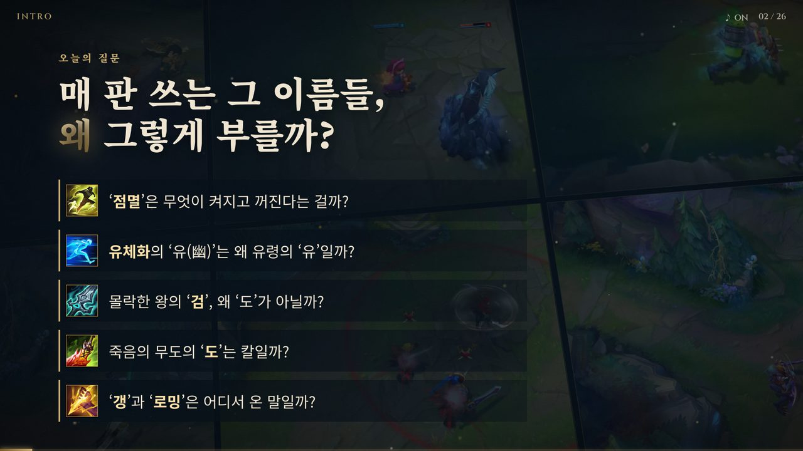

### 1장 · 소환사 주문 (3–13)

**점멸 點滅** — 라이엇 공식 점멸 영상에서 챔피언이 순간이동하는 순간에 맞춰 섬광과 충격파가 터지고 `點滅`이 쾅 찍힙니다.
點(켤 점)과 滅(꺼질 멸)을 차례로 해부해 “켜졌다 꺼졌다 = 깜빡임”으로 정리하고, 도로 위 ‘황색 점멸등’으로 마무리합니다.

<p>
  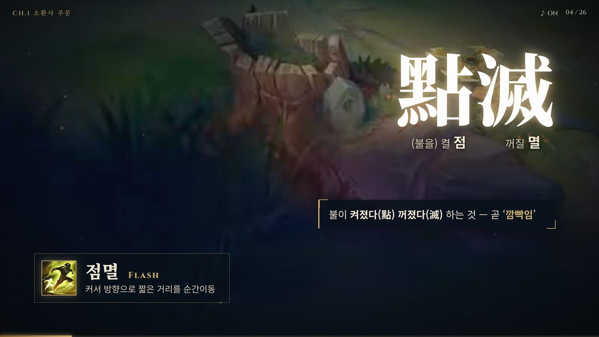
  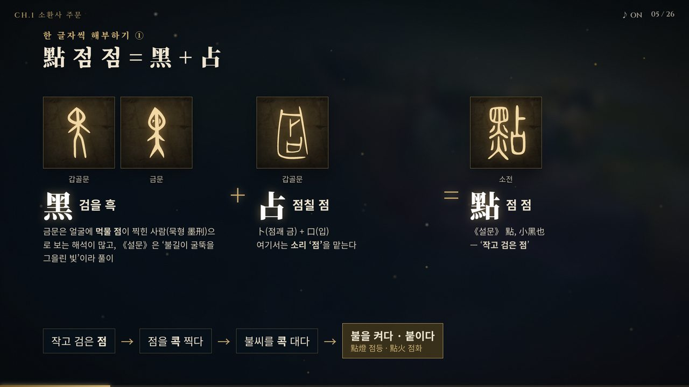
</p>
<p>
  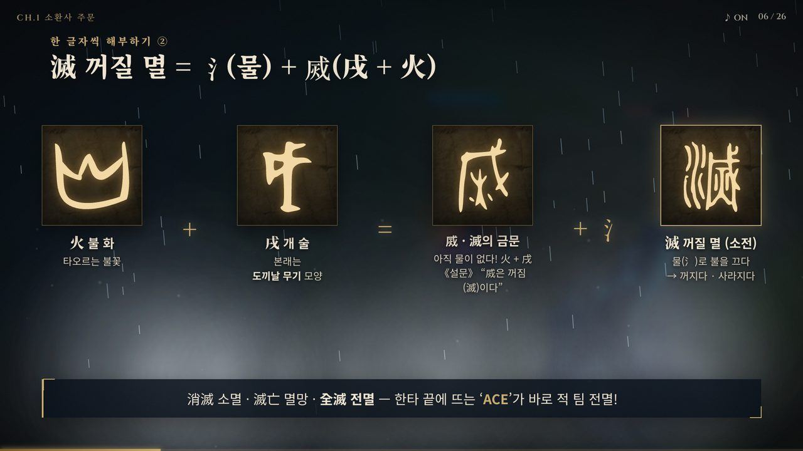
  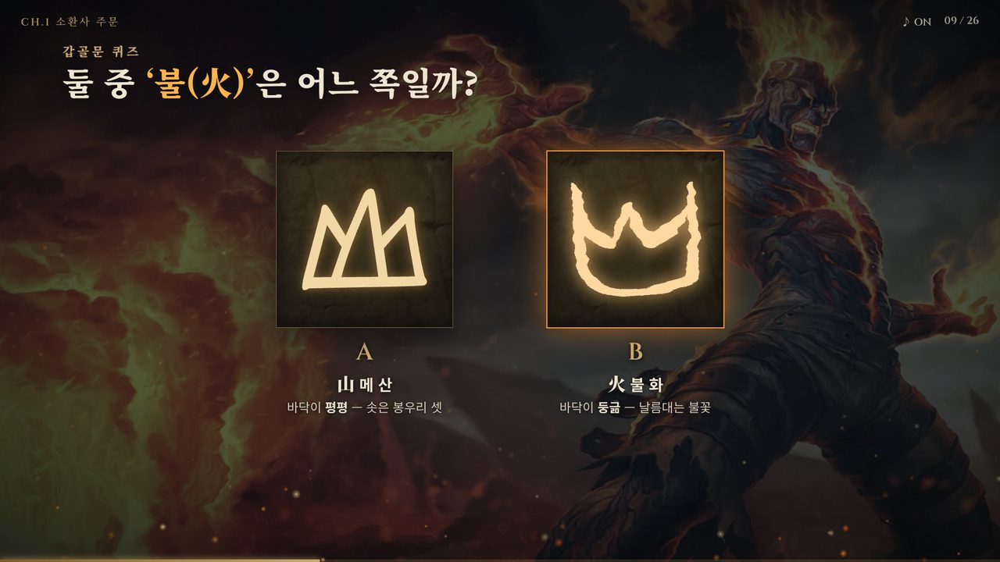
</p>

**점화 點火** — 점화가 실제로 불붙는 순간에 맞춰 불꽃이 터집니다. “點이 또 나왔다”로 앞 내용과 이어지고, 갑골문 火와 山이 쌍둥이처럼 닮았다는 퀴즈(위 오른쪽)로 다음 글자를 예고합니다.

**유체화 幽體化** — 幽의 갑골문(실타래 둘 + 火 = 실처럼 희미한 불빛)이 나중에 火 → 山으로 바뀐 과정, 體(骨 + 豊), 化(바로 선 사람 + 거꾸로 선 사람)를 거쳐 “희미한 몸이 되다 = 유닛을 통과하는 몸”으로 정리합니다.

<p>
  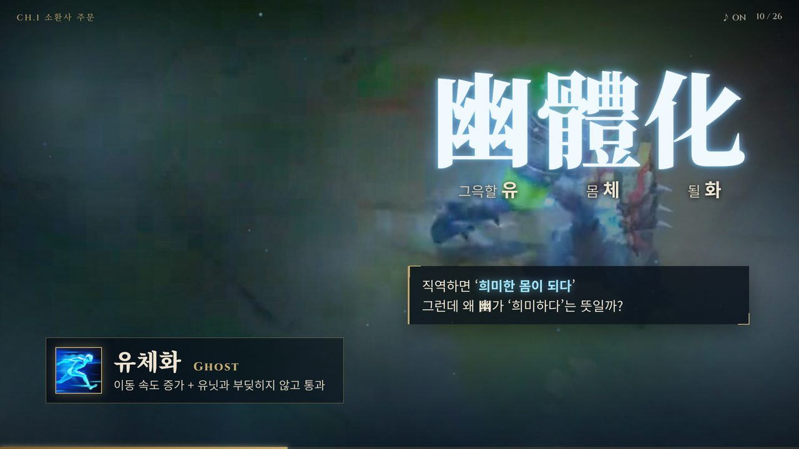
  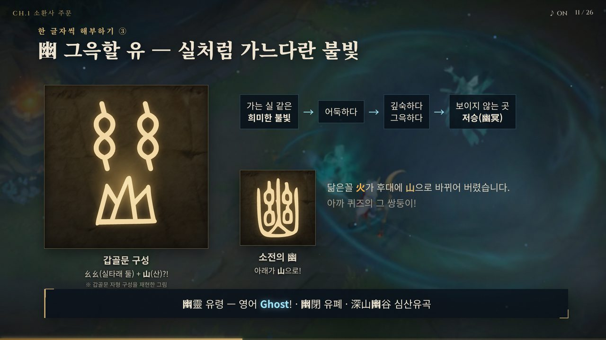
</p>

마지막으로 강타 · 탈진 · 정화 · 순간이동 · 회복 · 방어막을 카드 뒤집기로 3초씩 해독합니다.

<details>
<summary>1장 장면 목록</summary>

| # | 장면 | 배경 영상 · 사진 |
| --- | --- | --- |
| 3 | CH.1 소환사 주문 (召喚師 呪文) | 점멸 · 점화 · 유체화 영상 세 폭 |
| 4 | 점멸 點滅 | 점멸 공식 소개 영상 |
| 5 | 點 = 黑 + 占 | 黑 갑골문·금문, 占 갑골문, 點 소전 |
| 6 | 滅 = 氵 + 烕 | 火 · 戌 · 滅(금문 · 소전) — 불씨 → 비 → 수증기 |
| 7 | 點滅 = 깜빡임 | 켜졌다 꺼지는 네온 글자, 황색 점멸등 |
| 8 | 점화 點火 | 점화 공식 소개 영상 |
| 9 | 火 vs 山 | 갑골문 퀴즈 → 火의 변천(갑골문 → 금문 → 소전 → 해서) |
| 10 | 유체화 幽體化 | 유체화 공식 소개 영상 |
| 11 | 幽 — 희미한 불빛 | 카서스 패시브(영혼 상태) 영상 |
| 12 | 體 · 化 | 헤카림 E 영상 |
| 13 | 나머지 주문 해독 | 強打 · 脫盡 · 淨化 · 瞬間移動 · 回復 · 防禦幕 |

</details>

### 2장 · 아이템 속 무기 (14–20)

**몰락한 왕의 검** — 비에고의 Q(스킬 이름도 ‘몰락한 왕의 검’) 영상 위에서 沒落 · 王(갑골문은 큰 도끼날) · 劍을 풀고 “왜 ‘도’가 아니라 ‘검’일까?”를 묻습니다.

**劍 vs 刀** — 월왕 구천검과 상나라 청동 칼 실물 사진으로 대결 화면을 만들었습니다. 刀는 상나라 갑골문에 이미 있지만 양날 검인 劍은 없다는 점, 刃(刀 + 점 하나)이 ‘날은 여기!’를 가리킨 글자라는 점을 다룹니다.

**죽음의 무도** — 아이콘은 휜 칼날이라 ‘刀’라고 짐작하기 쉽지만, 정답은 舞蹈(춤출 무 · 밟을 도)입니다. 武道 · 舞蹈 · 無道 중 고르는 함정 퀴즈 뒤에 舞(본래 無가 춤추는 사람) · 蹈(足 + 舀)를 해부합니다.

<p>
  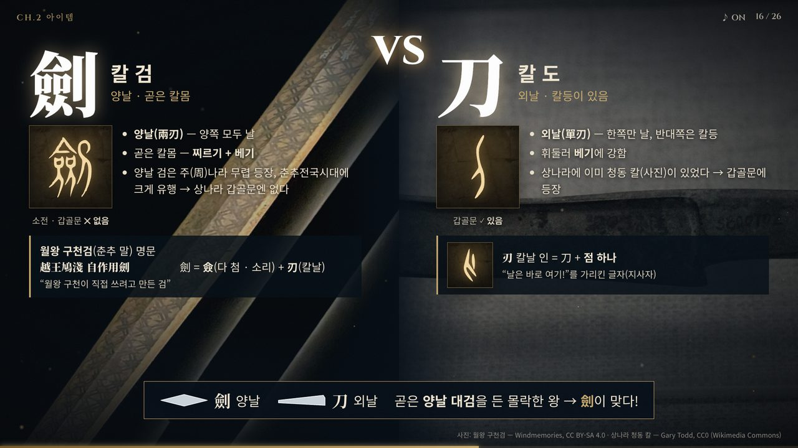
  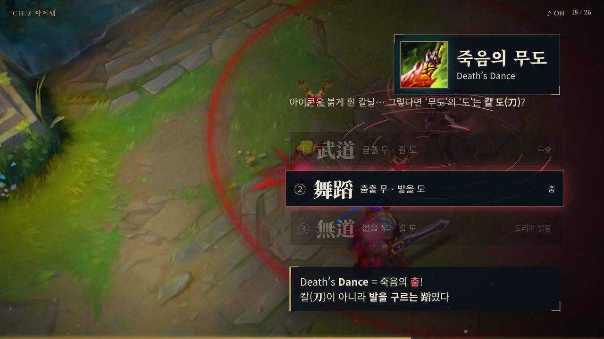
</p>
<p>
  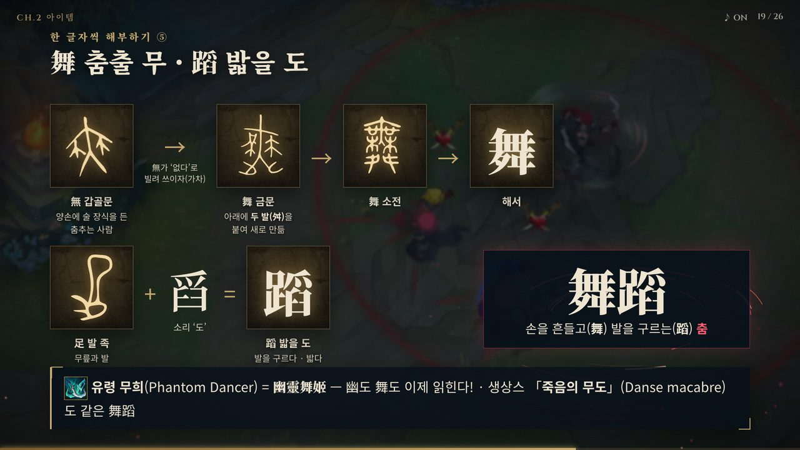
</p>

<details>
<summary>2장 장면 목록</summary>

| # | 장면 | 배경 영상 · 사진 |
| --- | --- | --- |
| 14 | CH.2 아이템 속 무기 | 비에고 스플래시 아트 |
| 15 | 몰락한 왕의 검 | 비에고 Q 영상 |
| 16 | 劍 vs 刀 | 월왕 구천검 · 상나라 청동 칼 사진 |
| 17 | 협곡 속 검과 도 | 가렌 Q · 야스오 Q 영상 (검도 劍道 이야기) |
| 18 | 죽음의 무도 — 함정! | 카타리나 R(죽음의 연꽃) 영상 |
| 19 | 舞 · 蹈 | 無 → 舞의 변천, 足 + 舀, 유령 무희(幽靈舞姬) 복습 |
| 20 | 같은 ‘도’, 다른 한자 | 刀 · 道 · 蹈 |

</details>

### 보너스 · 갱과 로밍 (21–23)

한자어는 아니지만 매일 쓰는 게임 용어의 뜻과 어원입니다.

- **갱(Gank)** — 1980년대 미국 속어(등쳐 먹다)에서 1990년대 후반 온라인 게임의 ‘여럿이 덮쳐 잡다’로 넘어온 흐름. 화면에는 렝가 영상 위로 붉은 심장박동과 위험 핑이 반복됩니다.
- **로밍(Roaming)** — roam(돌아다니다)의 뜻을 휴대폰 ‘해외 로밍’에 빗대어 “내 라인(홈)을 떠나 다른 라인으로”로 설명합니다. 약도 위에 로밍 경로가 그려집니다.

<p>
  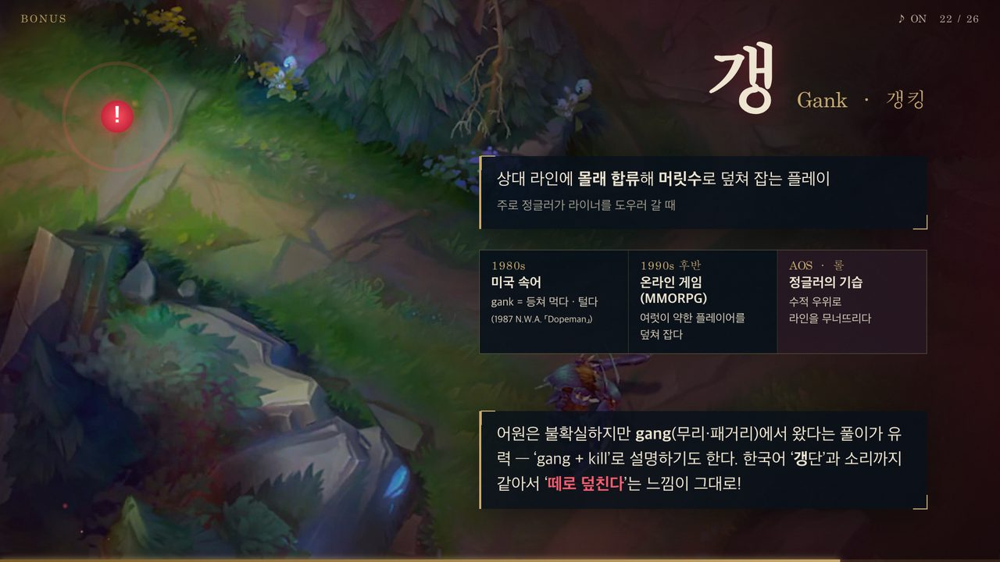
  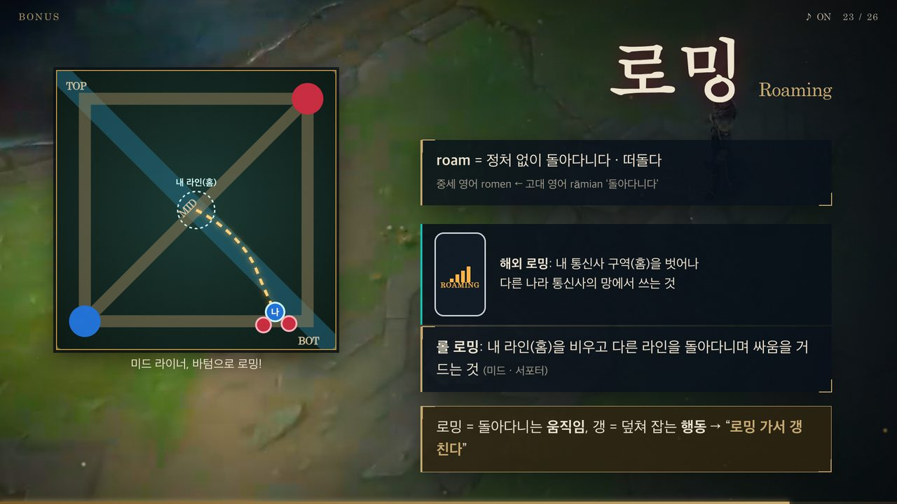
</p>

### 마무리 (24–26)

복습 퀴즈 4문제 → 오늘 배운 한자 12자가 옛 글자에서 오늘날 한자로 뒤집히는 “획득한 한자” 화면과 GG → 출처 장면.

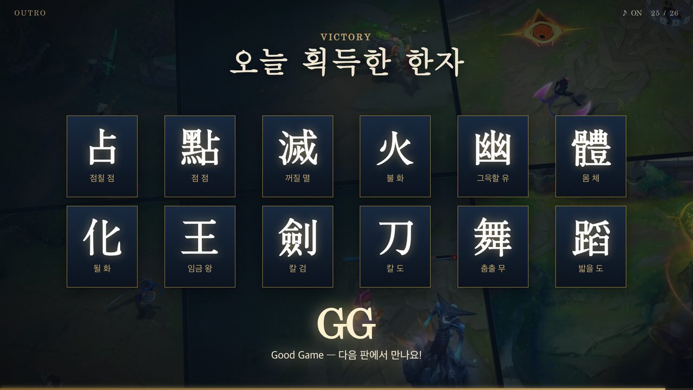

## 화면 위 이펙트

- **영상 타이밍에 맞춘 연출** — 점멸(2.05초) · 점화(2.6초) · 유체화(3.7초)가 실제로 발동하는 프레임에 맞춰, 영상 속 챔피언 위치에서 섬광 · 충격파 · 불꽃이 터집니다. 영상은 반복 재생되고 연출도 매번 다시 맞춰집니다.
- **고문자 새김** — 갑골문 · 금문 · 소전 그림이 거북 배딱지 질감의 칸 위에 금빛 윤곽선부터 새겨진 뒤 채워집니다.
- **장면별 파티클** — 불씨, 비와 수증기, 유령 안개, 칼날 회오리, 베기 궤적, 위험 핑 등.
- **효과음** — 파일 없이 브라우저(WebAudio)에서 즉석으로 합성합니다. <kbd>M</kbd>으로 영상 소리와 함께 끌 수 있습니다.

## 수업 전에 알아 둘 점

- **幽의 갑골문은 재현도입니다.** Wikimedia Commons에 幽의 갑골문 그림이 없어, 실제 火 · 山 갑골문 위에 실타래(幺幺)를 얹어 구성을 재현했습니다. 화면과 발표자 노트에도 적혀 있습니다.
- **‘갱’의 어원은 확정되지 않았습니다.** gang에서 왔다는 풀이가 유력하고 ‘gang + kill’로 설명하기도 하지만, 사전들은 기원을 불확실하다고 봅니다. 자료에도 그렇게 적었습니다.
- 갑골문의 기초(甲骨文이란 무엇인가, 卜 · 占)는 이전 수업에서 다룬 것으로 보고 바로 소환사 주문부터 시작합니다.
- 각 장면에서 <kbd>N</kbd>을 누르면 설명 포인트와 학생에게 던질 질문이 정리된 발표자 노트가 나옵니다.

## 폴더 구조

```
lol-hanja/
├── index.html            # 26개 장면 (장면 = <section class="scene">)
├── css/deck.css          # 1920×1080 무대, 레이아웃, 등장·새김 애니메이션
├── js/
│   ├── deck.js           # 장면 이동, 단계 공개, 영상 큐, 장면별 이펙트, HUD·노트·목차
│   ├── fx.js             # 캔버스 파티클 엔진 + WebAudio 효과음
│   └── glyphs.js         # 고문자 SVG 데이터 (tools/build_glyphs.py가 생성)
├── assets/
│   ├── video/            # 소환사 주문 · 챔피언 스킬 영상 (H.264)
│   ├── img/              # 스플래시 아트, 아이템·주문 아이콘, 박물관 사진
│   └── glyphs/           # 갑골문·금문·소전 원본 SVG (Wikimedia Commons)
├── docs/screenshots/     # 이 문서의 스크린샷
└── tools/build_glyphs.py # glyphs.js 생성 스크립트
```

## 고문자 데이터 다시 만들기

`file://`로 열면 브라우저가 외부 SVG를 읽어 애니메이션하는 것을 막기 때문에, 고문자 SVG는 `js/glyphs.js`에 미리 넣어 둡니다.
`assets/glyphs/`에 SVG를 추가하거나 바꾼 뒤 아래 명령으로 다시 만듭니다.

```sh
python3 tools/build_glyphs.py
```

HTML에서는 `<i class="g" data-g="火-oracle"></i>`처럼 파일 이름(확장자 제외)으로 불러옵니다.

## 출처 · 참고 자료

- **게임 영상 · 이미지** — League of Legends © Riot Games, Inc.
  소환사 주문 소개 영상(라이엇 공식 클라이언트 쇼케이스), 챔피언 스킬 영상(라이엇 공식 챔피언 페이지 영상), 스플래시 아트 · 아이템 · 주문 아이콘(CommunityDragon 경유 게임 데이터).
  Riot Games의 팬 콘텐츠 정책([Legal Jibber Jabber](https://www.riotgames.com/en/legal))에 따른 비상업적 교육용 사용입니다.
- **고문자 자형** — [Wikimedia Commons](https://commons.wikimedia.org/) Ancient Chinese characters project의 갑골문 · 금문 · 소전 SVG (퍼블릭 도메인)
- **사진** (Wikimedia Commons)
  - Shang Tortoise Plastron Oracle Bone — Gary Todd, CC0
  - Shang Ox Scapula Oracle Bones — Gary Todd, CC0
  - Shang Bronze Knife — Gary Todd, CC0
  - [Bronze sword used by King Goujian of Yue](https://commons.wikimedia.org/wiki/File:20230208_Bronze_sword_used_by_King_Goujian_of_Yue_01.jpg) — Windmemories, [CC BY-SA 4.0](https://creativecommons.org/licenses/by-sa/4.0/)
- **참고 자료** — 《說文解字》, Wiktionary 한자 항목([幽](https://en.wiktionary.org/wiki/幽) · [滅](https://en.wiktionary.org/wiki/滅) · [黑](https://en.wiktionary.org/wiki/黑) · [劍](https://en.wiktionary.org/wiki/劍) · [舞](https://en.wiktionary.org/wiki/舞) · [蹈](https://en.wiktionary.org/wiki/蹈)), [Online Etymology Dictionary — gank](https://www.etymonline.com/word/gank), [Dictionary.com — gank](https://www.dictionary.com/e/slang/gank/), [Wiktionary — roam](https://en.wiktionary.org/wiki/roam)

자료를 배포할 때는 CC BY-SA 사진 표기가 들어 있는 마지막 출처 장면(26번)을 함께 포함해 주세요.
